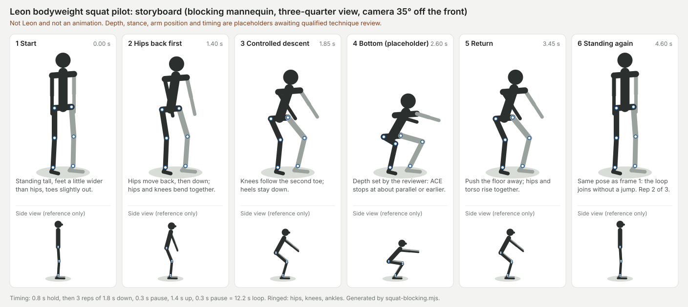

# Leon bodyweight squat pilot

Status (19 Nov 2026): **production package only; no animation exists.** Leon is available only as flat rendered
images. There is no 3D model, rig or animation source, and no modelling, rigging or video tool on the development machine.
Nothing was added to the app: the brief says not to show a placeholder. The wger demonstrations (`feature/wger-demonstrations`) are untouched
and remain the working fallback.

- Branch: `feature/leon-squat-pilot`, from `feature/wger-demonstrations` d591add (app code 197da49, IPA 81). It
  depends on that unmerged branch only because the future preview will reuse its player, `DemoStore` and the shared
  sheet. This branch changes docs only.
- Package: this file; [avatar-pilot/ARTIST_BRIEF.md](avatar-pilot/ARTIST_BRIEF.md) (send-ready);
  [avatar-pilot/storyboard.svg](avatar-pilot/storyboard.svg) and its generator
  [avatar-pilot/squat-blocking.mjs](avatar-pilot/squat-blocking.mjs).
- wger sourcing is paused; nothing in `exercise-media.json` changed.

## 1. Inventory (checked 19 Nov 2026)

| Asset | What exists | Where |
|---|---|---|
| Full-body Leon | One pose (front three-quarter, thumbs up, left hand in pocket), 1024 × 1536 RGBA PNG, with a glow baked into the background | `design/coach/assets/leon-full.png` (= `app/assets/coach/leon-full.png`) |
| Head and shoulders | 1254 × 1254 RGBA avatar; bust crop | `design/coach/assets/leon-avatar.png`, `app/assets/coach/leon-bust.png` |
| Concept board | The approved concept, 1254 × 1254 RGB, with UI mock-up text and a "G/H" garment mark that is **not** a logo | `GoHard_Coach_Handoff/references/leon-approved-concept.png` (untracked folder) |
| Leona | The same three kinds of file | same folders, `leona-*` |
| Turnaround (side, back), expression sheet, layered or source files | **None** | — |
| 3D mesh, materials/textures, fur or mane groom | **None** | — |
| Skeleton/rig, facial rig | **None** | — |
| Animation | **None.** `coach_avatar.dart` states that nothing in the app talks, blinks or walks. The coach evidence recordings are screen captures of the app. | — |
| Provenance | `design/coach/ASSETS.md`: "generated for this handoff from the approved concept boards … static raster artwork, not a Rive/Lottie file, 3D model, sprite sheet or animation rig." The generator, its terms, the prompts and the date are not recorded. | — |

Searched: every branch (including `agent/art`, `agent/motion`, `feature/coach-companion`), the untracked handoff folders, and
Downloads, Documents, Desktop, Pictures and `C:\dev`. I looked for `.blend .fbx .glb .gltf .vrm .riv .usdz .ma .mb .c4d .psd .kra`.
The only hits were Python's own icon sources and an unrelated older app's splash `.riv`.

**Tools on this machine:** Node 22, Python 3.13 (no imaging libraries), Edge (headless SVG rendering), Flutter with
`video_player`. **Not installed:** Blender or any 3D package, ffmpeg/ffprobe, ImageMagick. Blender and ffmpeg are free, but
a free tool does not supply the missing part, which is character modelling and grooming. A model built from scripted primitives would not look like
Leon, and a moving portrait does not contain a body or a skeleton. So this round follows the "missing assets" path: a production
package, plus a storyboard drawn from a blocking mannequin that is plainly labelled as not Leon.

**Rights to check before commissioning**

- The Leon artwork is generated imagery with no recorded source. Record which tool made it and confirm its terms allow commercial use and derivative work. Copyright
  protection for purely generated images is limited in many places, so the commissioned model is the asset to own. The contract
  should assign copyright (or an exclusive, perpetual, worldwide licence) in the model, rig, textures, groom, scene files
  and renders, including the source files.
- No third-party asset was used in this package. The mannequin and storyboard are generated by code in this repository.
- The artist may use a base mesh, auto-rig, texture, HDRI or motion library only if its licence allows commercial use in an app,
  modification and distribution as rendered video. Each one must be listed with its URL and licence. No generative video or
  AI motion. No motion-capture clip from another person's library without a licence that allows it.

## 2. Technique references (for the brief and the reviewer)

- **ACE Exercise Library, "Bodyweight Squat"** (beginner, no equipment), read 19 Nov 2026:
  <https://www.acefitness.org/resources/everyone/exercise-library/135/bodyweight-squat/>.
  - Setup: feet slightly wider than hip-width, toes turned slightly out, shoulders down and back, core braced, chest up.
  - Descent: shift the hips back, then down, so hips and knees hinge together. Lower until the thighs are parallel or almost parallel, or stop earlier
    if the heels lift or the torso rounds. The feet don't move, and the knees stay over the second toe.
  - Return: keep back, chest and head up, push through the feet, and let hips and torso rise together.
- **Matthew Cain, ACE, "How to Squat Properly: Body Type Breakdown & Anatomy Considerations"** (14 Aug 2019):
  <https://www.acefitness.org/resources/pros/expert-articles/7356/how-to-squat-properly-body-type-breakdown-anatomy-considerations/>.
  Hip anatomy differs, so stance width and toe position should be whatever is most comfortable. There is no single correct
  form for everyone.

So the pilot shows **one** reasonable bodyweight squat, not a universal standard. The storyboard's angles, depth and stance
width are placeholders. The qualified reviewer sets them, and the sheet's written text must not quote angles or say "correct form".
The app's existing three cues for `bodyweight-squat` (coach guide) agree with ACE, but they still list no sources. Adding ACE to
them belongs to the review step, not to this branch.

An NSCA article on adapting the squat to body proportions was found, but its PDF could not be read here, so it is not cited.

## 3. Character design (proposed, for the owner's review)

What stays the same as `leon-full.png`:
- The face: amber-brown eyes, heavy dark brows, dark-brown nose, cream muzzle and chin.
- The large dark-brown mane, the tan fur and rounded ears, and the tail with its dark tuft.
- A calm, confident expression with the mouth closed during the movement.
- An athletic build that isn't exaggerated.

**Proposed changes for demonstrating exercises** (new interpretations, not approved brand artwork):

1. **Clothing.** The artwork's loose joggers hide the knees. Proposal: the same charcoal fitted T-shirt, with no mark, and charcoal
   training shorts ending above the knee (or fitted charcoal tights), so hips, knees and ankles are visible. Keep the white
   trainers with flat soles. The heel line must be visible.
2. **Mane.** Shape it to sit behind the shoulder line, so neither shoulder joint nor the neck–chest line is hidden from three-quarter front. No mane
   simulation; at most a slight settle.
3. **Tail.** It hangs behind on the side away from the camera, never crossing a leg or touching the floor, with minimal sway.
4. **Proportions.** Keep the stylised head. Limb lengths and joint positions should be human-plausible, so the knee hinge,
   hip crease and ankle sit where a person's would. Hands as in the artwork (five fingers).
5. **Expression.** A neutral, attentive face looking forward. An occasional subtle blink is optional. No talking, winking or celebrating.

**For Leona later.** Use the same skeleton, bone names and proportion targets, with her own mesh and groom. The squat animation should then retarget with
corrections only. Leona is not part of this pilot.

## 4. Rig requirements

- A humanoid skeleton with conventional names: pelvis, three spine bones, neck, head, jaw, eyelids, ears, clavicles, arms with
  twist bones, hands with fingers, thighs and shins with twist bones, feet, toes, and a tail chain of 6–8 bones.
- IK legs with heel/ball/toe pivots and foot locking. Knee pole targets so each knee can be steered over its foot's second toe. IK/FK arms.
- Clean deformation at deep knee flexion (≥ 125°), deep hip flexion with the trunk leaning (≥ 110°) and the arms raised forward.
  Corrective shapes at knees, hip crease, glutes, shoulders and elbows. Nothing pinches or collapses.
- No intersections between mane and shoulders, arms and thighs, belly and thighs at the bottom, tail and legs or floor, or between layers of clothing.
- Deliver as Blender `.blend` (free, so GoHard can open it) plus FBX or glTF of the mesh, skeleton and action.

## 5. Squat storyboard and camera



The board above is drawn from the blocking mannequin in `squat-blocking.mjs`, a figure of capsules and dots that is
**not Leon**. Its feet are fixed points, and each knee is solved towards its own foot. A script check confirms that the feet never move,
segment lengths stay constant and the rough centre of mass stays over the feet. It is a timing and framing reference for
the animator, not an instruction or an approved pose.

- **Sequence:** start standing still (0.8 s), then 3 reps: 1.8 s down, 0.3 s at the bottom, 1.4 s up, 0.3 s standing.
  The loop is **12.2 s**. The last frame equals the first, so it loops without a jump. The tempo is a production choice for
  "controlled", not a prescription; the reviewer may change it.
- **Order within a rep (ACE):** the hips start back before the knees travel far. Hips and torso rise together on the way up. Heels stay down, and
  the knees track over the second toe throughout.
- **Arms:** the board raises them forward as a counterbalance. ACE's setup has the hands by the sides. This is **an open choice for the
  reviewer**; arms at the sides partly hide the hip in three-quarter view.
- **Camera:** locked, three-quarter front, about 35° off the front. Leon faces towards screen right, the reading direction in en/fr.
  The same clip is used in Arabic; whether to mirror it is a later decision. Use a 50 mm-equivalent lens to limit distortion,
  placed at about hip-to-chest height and tilted down 5–10°. The whole body (ears, mane, hands, tail tuft and shoes) stays in
  frame with at least 5% margin in every pose. No reframing, cuts, zoom or camera shake.
- **Side view:** the board includes one so the reviewer can judge trunk angle and depth. The clip itself is three-quarter
  only. Add a separate side-view clip (not a split screen) only if the reviewer says the three-quarter view hides something.

## 6. Materials, lighting and background

- Match the look of the artwork's render: stylised 3D, soft fur, slightly warm. Shade the fur so it does not flicker or crawl in
  compressed video. Fine noisy strands waste bits and look like compression artefacts.
- A soft key light from front-left above, a fill, and a gentle warm rim to separate mane and clothes from the background. Do **not**
  copy the PNG's glow halo; it is not part of the character.
- Background and floor: one plain light neutral (around `#E9EBE8`), with a soft contact shadow under each shoe so contact is visible. A light background keeps
  the charcoal clothes readable. No props, text, logo, watermark or burned-in labels; the "not yet reviewed" label lives in the app UI.
- Little or no motion blur, so 0.5× playback stays sharp.

## 7. Export requirements

- **Delivery clip:** H.264 MP4, High profile, level ≤ 4.0, 8-bit `yuv420p`, **720 × 720 at a constant 30 fps**, 12.2 s, **no audio
  track**, `moov` at the front (faststart), metadata stripped, target **≤ 2.5 MB**.
  - Why square: the standing pose and the bottom with arms forward both fit without reframing.
  - The sheet sizes the player from the clip's own aspect ratio (`DemoVideo.aspectRatio`), so a square clip sits at the sheet's width (about 360 pt on a phone)
    without taking over the sheet. Full screen in portrait fills the width.
  - The wger clips that play on device are H.264 High at levels 3.0–4.0.
- **Masters:** a lossless PNG sequence (or ProRes 422 HQ) at 1440 × 1440, 30 fps, so the clip can be re-encoded or recropped later.
- **Poster:** frame 1 (the standing start pose, identical to the loop start) as JPEG, 720 × 720, quality about 82.
  - The picker's 56 × 40 thumbnail uses `BoxFit.cover` and would cut the head and feet. Integration will either add a thumbnail crop or accept that;
    decide when the clip exists.
- **Suggested encode** (free ffmpeg; check the result with `ffprobe`):

  ```sh
  ffmpeg -framerate 30 -i master/leon_squat_%04d.png \
    -vf "scale=720:720:flags=lanczos,format=yuv420p" \
    -c:v libx264 -profile:v high -level:v 4.0 -preset slow -crf 21 -g 60 \
    -an -map_metadata -1 -movflags +faststart leon_bodyweight-squat_3q_720.mp4
  ffmpeg -i master/leon_squat_0001.png -vf scale=720:720 -q:v 4 leon_bodyweight-squat_3q_720.jpg
  ```

- **Names and structure** (so Leona and other exercises can follow):
  `characters/leon/leon.blend` (mesh, materials, groom, rig), `exercises/bodyweight-squat/bodyweight-squat.blend` (links the
  character; holds the action, camera and lights), `exercises/bodyweight-squat/master/leon/`, and exports named
  `<character>_<catalogue-key>_<view>_<size>.mp4`.
  - Keep the large source files somewhere GoHard controls, not in this repository. This repository keeps only the small export and its SHA-256.
  - No paid storage was created for this.

## 8. Acceptance criteria (four separate sign-offs)

1. **Owner, likeness and design:** compare with `leon-full.png` at thumbnail size and full screen. Clothing proposal approved.
   Leona compatibility understood.
2. **Animation quality** (animator's self-check, then the owner):
   - Shoes stay locked: no slide of more than 1 px at 720, no floating, contact shadows present.
   - No intersections, and no joint pops or jitter in the curves.
   - Knees track consistently, with left and right symmetric.
   - Fur and mane stable, the camera locked, the whole body framed in every frame.
   - First and last frames identical. Three complete reps.
3. **Technique (a qualified reviewer**, for example a certified strength coach or physiotherapist):
   - Checks stance, toe angle, depth, trunk angle, heel contact, knee path, head and neck, arm position and tempo, plus the written Setup/Movement
     text shown beside the clip.
   - Record their name, credential and date in this file. Until then every surface says **"Leon squat pilot — not yet reviewed"**
     and the clip is never shown to users.
4. **Technical (developer):**
   - `ffprobe` shows h264/High/≤ 4.0, yuv420p, 720 × 720, 30 fps, about 12.2 s, no audio stream, size ≤ 2.5 MB.
   - In the existing player on the Android emulator and on an iPhone it plays only after a tap, muted, with Pause, Replay, 0.5× and full screen, and it pauses when the sheet closes or the app
     goes to the background, while music keeps playing.
   - A file extension is not proof of compatibility.

## 9. Development preview, once a clip exists (not built now)

- A preview that only developers can see, behind a `--dart-define` flag, never in the public `exercise-media.json`.
  - It is keyed to the exact catalogue key `bodyweight-squat`, never `back-squat`, `goblet-squat` or another squat.
  - It opens the shared sheet from `feature/wger-demonstrations` with the label "Leon squat pilot — not yet reviewed".
- The player needs a local-asset source (today it streams from a URL or plays a downloaded file). The clip must stay out of release builds: use a
  development flavour's assets, or load it from the developer's device during testing.
- Tests to add then:
  - The preview never replaces or merges into public media.
  - Opening and closing it leaves sets, selection, typed values, notes, clocks, plan drafts and workouts unchanged; reuse the wger tests.
  - Plus the l10n and accessibility checks.
- Build one unsigned IPA from that tested commit.

## 10. Smallest next action

Send [avatar-pilot/ARTIST_BRIEF.md](avatar-pilot/ARTIST_BRIEF.md) with `leon-full.png`, `leon-avatar.png` and
`storyboard.svg` to a 3D character artist or studio and ask for a quote. That is the owner's decision; nothing was purchased
or commissioned. In parallel, decide the clothing proposal (section 3) and name a qualified technique reviewer.
