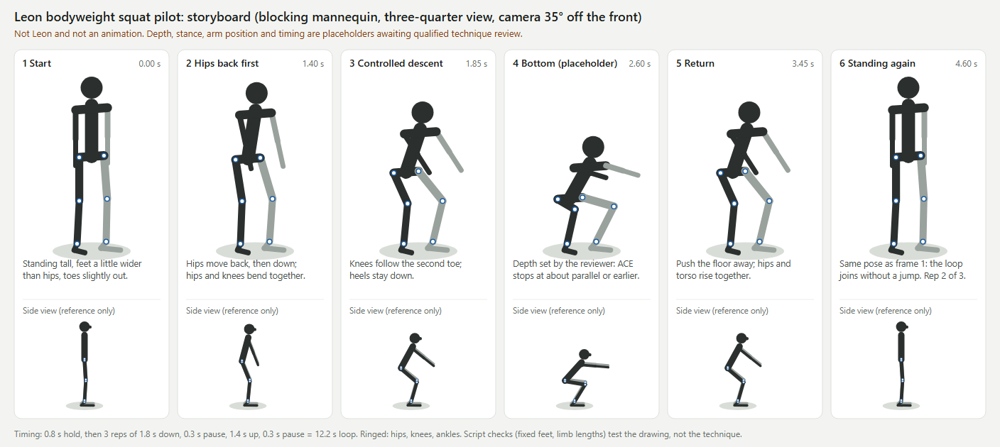

# Leon bodyweight squat pilot

Status (19 Nov 2026): **ready to request quotes; nothing commissioned, bought or animated.**
- Leon exists only as 2D images generated with ChatGPT. There is no 3D model, rig or animation.
- No image-generation or 3D tool was available here, so no new character views were made. Section 3 says exactly what the artist must supply.
- The app is unchanged. The wger demonstrations (`feature/wger-demonstrations`) remain the working fallback, and wger sourcing is paused.

- Branch: `feature/leon-squat-pilot`, from `feature/wger-demonstrations` d591add (app code 197da49, IPA 81).
  - It depends on that unmerged branch only because the eventual preview will reuse its player, `DemoStore` and the shared sheet.
  - This branch changes docs only.
- Package:
  - this file;
  - [avatar-pilot/ARTIST_BRIEF.md](avatar-pilot/ARTIST_BRIEF.md), the detailed brief for the artist;
  - [avatar-pilot/storyboard.png](avatar-pilot/storyboard.png), with its source [storyboard.svg](avatar-pilot/storyboard.svg) and the generator
    [squat-blocking.mjs](avatar-pilot/squat-blocking.mjs).
  - Section 8 has the message to send and the list of attachments.

## 1. Inventory (checked 19 Nov 2026)

| Asset | What exists | Where |
|---|---|---|
| Full-body Leon | One pose: front three-quarter, thumbs up, left hand in pocket, joggers. 1024 × 1536 RGBA, with a glow baked into the background. | `design/coach/assets/leon-full.png` (original, with Content Credentials) |
| Face | Head-and-shoulders avatar, 1254 × 1254 RGBA | `design/coach/assets/leon-avatar.png` (original) |
| Concept board | The approved concept, 1254 × 1254 RGB. It includes mock-up text, an app banner and a "G/H" garment mark, which is **not** a logo. | `GoHard_Coach_Handoff/references/leon-approved-concept.png` (untracked folder) |
| App copies | Resized runtime versions, plus a bust crop. Resizing removed the Content Credentials. | `app/assets/coach/leon-*.png` |
| Turnaround, expression sheet, layered files | **None** | — |
| 3D mesh, textures, fur or mane groom, rig | **None** | — |
| Animation | **None.** `coach_avatar.dart` states nothing in the app talks, blinks or walks. | — |

Searched: every branch, the untracked handoff folders, and Downloads, Documents, Desktop, Pictures and `C:\dev`. I looked for
`.blend .fbx .glb .gltf .vrm .riv .usdz .ma .mb .c4d .psd .kra`. **Tools here:** Node 22, Python 3.13 (no imaging libraries)
and Edge. No image-generation tool, no 3D package, no ffmpeg.

## 2. Origin of the artwork

**Known**, from the C2PA Content Credentials embedded in each original PNG. I read these fields from the files; I did not verify
the signatures cryptographically.

| File | Created (UTC) | Recorded software | Source type |
|---|---|---|---|
| `leon-approved-concept.png` | 2026-10-15 12:45:05 | ChatGPT, `gpt-image`; claim generator "OpenAI Media Service API" | `trainedAlgorithmicMedia` (IPTC: AI-generated) |
| `leona-approved-concept.png` | 2026-10-15 12:49:45 | same | same |
| `leon-full.png` | 2026-10-15 12:55:28 | same | same |
| `leona-full.png` | 2026-10-15 12:56:08 | same | same |
| `leona-avatar.png` | 2026-10-15 12:57:34 | same | same |
| `leon-avatar.png` | 2026-10-15 12:58:40 | same | same |

- The signing certificate names OpenAI OpCo, LLC ("OpenAI Media Service"), issued by Trufo's C2PA signing CA, and the
  timestamps come from OpenAI's timestamp authority.
- No manifest lists an "ingredient" (input image).
- The repository's own records agree: `design/coach/ASSETS.md` and `manifest.json` say "generated … from the approved concept
  boards", and the app's avatars were added on 15 Oct 2026 (a7a116b).
- To re-check: open the original PNG in a Content Credentials viewer, such as the C2PA project's `c2patool` or the public
  verify site. The site uploads the file, so that is your choice.

**Owner's statement (19 Nov 2026):** Leon was created in the owner's own ChatGPT account from text prompts only, and no reference
images were uploaded. This is consistent with the credentials, which list no ingredients.

**Still unknown:** the exact prompts, which are not kept in this repository, and so the account plan and terms that applied
on 15 Oct 2026.

**Not concluded:** the word "generated" says nothing about commercial rights. Rights depend on the terms of the account used
and on what went into the prompts. Copyright in purely AI-generated images may be limited, so the human-made 3D model and its
source files are the assets to secure by contract. The artist brief states this uncertainty openly.

## 3. Character design for approval

**Direction from the owner (19 Nov 2026):**
- fitted athletic shorts above the knee;
- shoulders, elbows, hips and ankles easy to see;
- mane and tail kept clear of the movement;
- a simple background with clear contrast.

**Keep from the artwork:**
- amber-brown eyes, heavy dark brows, a dark-brown nose, a cream muzzle and chin;
- the large dark-brown mane, tan fur, rounded ears, and a tail with a dark tuft;
- a calm, confident expression and an athletic build that isn't exaggerated.

**Exercise version** (a proposal until you approve the artist's design sheet):
- **Clothing:**
  - A plain charcoal fitted T-shirt with sleeves ending above the elbow, no logo and no "G/H" mark.
  - Charcoal fitted athletic shorts ending above the knee.
  - White trainers with flat soles and a visible heel and ankle.
- **Mane:** shaped to sit behind the shoulder line, so it never hides a shoulder, the neck–chest line or an elbow in the clip's
  three-quarter view. No simulation beyond a slight settle.
- **Tail:** hangs behind, on the side away from the camera. It never crosses a leg or touches the floor; minimal sway.
- **Proportions:** the stylised head stays, while limb lengths and joint positions are human-plausible (knee hinge, hip
  crease and ankle where a person's would be). Hands as in the artwork.
- **Expression:** neutral and attentive while exercising. No talking or celebrating.
- **Contrast:** a plain, cool, light-grey background, so the warm tan fur and charcoal clothing both separate from it.
  Check: every major joint and the full silhouette still read when a frame is converted to greyscale.

**Concept views:** none were made here, because no image-generation tool is available. Stretching or repainting the
existing portrait would not be faithful. In milestone 1 the artist must supply:
1. Front, side and back views of Leon in the exercise clothing:
   - the same scale, aligned on height lines (top of head, ears, shoulder, elbow, wrist, hip, knee, ankle, sole);
   - in a neutral A-pose, plus one natural standing pose.
2. A three-quarter view matching the clip's camera.
3. A face sheet: front and side, in the reference expression.
4. Colour swatches for fur, mane, nose, eyes, inner ear, shirt, shorts and shoes.
5. A written note of anything they reinterpreted from the 2D artwork.

These are design references for your approval, not a modelling blueprint. Modelling starts only after you approve them.

**For Leona later:** the same skeleton and bone names, with her own mesh and groom. Not part of this pilot.

## 4. Rig requirements

- **Skeleton:** a humanoid skeleton with conventional names. Pelvis; three or more spine bones; neck; head; jaw; eyelids; ears; clavicles.
  Arms with twist bones; hands with fingers; thighs and shins with twist bones; feet; toes; a 6–8-bone tail chain.
- **Controls:**
  - IK/FK legs with heel, ball and toe pivots and foot locking;
  - IK/FK arms that can **lock the hands** to the floor or a bar;
  - knee and elbow pole targets.
- **Range:** must suit future upper- and lower-body exercises, not just the squat:
  - deep knee and hip flexion with the trunk leaning forward (squat, lunge, deadlift);
  - arms overhead with the shoulder blades moving (press, pull-up);
  - floor contact with hands and feet (push-up, plank);
  - grip sockets in both hands that can switch, so dumbbells, a barbell or a cable handle can be attached later.
- **Deformation:** correctives at knees, hip crease, glutes, shoulders, armpits and elbows. No intersections between the mane, arms, thighs, belly,
  clothing layers or tail.
- **Delivery:** Blender `.blend` preferred (free to open). Otherwise the artist's native files plus FBX or glTF of the mesh, skeleton and
  animation.

## 5. Squat storyboard and camera



The board is drawn from a stick mannequin (`squat-blocking.mjs`) and is **not Leon**.
- Its script checks that the feet stay fixed, limb lengths stay constant and the centre of mass stays over the feet. **These are drawing checks, not evidence
  of correct technique.** Depth, stance, arm position and tempo are placeholders for the technique reviewer.
- **Sequence:** stand still 0.8 s, then 3 reps of 1.8 s down, 0.3 s at the bottom, 1.4 s up and 0.3 s standing, a **12.2 s** loop.
  The last frame equals the first. The tempo is a production choice for "controlled".
- **In each rep** (ACE):
  - the hips start back before the knees travel far;
  - hips and knees bend together;
  - heels stay down and the knees track over the second toe;
  - hips and torso rise together.
- **Arms:** ACE's setup has the hands by the sides. The board raises them forward, which keeps the hips visible. The reviewer decides.
- **Camera:**
  - locked, three-quarter front at about 35° off the front, with Leon facing screen right;
  - 50 mm-equivalent lens at hip-to-chest height, tilted down 5–10°;
  - the whole body (ears, mane, hands, tail tuft and shoes) in frame with at least 5% margin in every pose;
  - no camera moves.
- **Side view:** the board's side row helps the reviewer. The clip is three-quarter only, unless the reviewer asks for a separate side clip.

**Technique references**
- ACE Exercise Library, "Bodyweight Squat" (read 19 Nov 2026):
  <https://www.acefitness.org/resources/everyone/exercise-library/135/bodyweight-squat/>
- Matthew Cain, ACE, "How to Squat Properly: Body Type Breakdown & Anatomy Considerations" (14 Aug 2019):
  <https://www.acefitness.org/resources/pros/expert-articles/7356/how-to-squat-properly-body-type-breakdown-anatomy-considerations/>.
  Stance width and toe position vary with hip anatomy, so the pilot shows one reasonable squat, not a universal standard.

## 6. Look, lighting and export

- **Look:** match the stylised 3D render of the artwork. Fur shading must not flicker or crawl in compressed video. A soft key from front-left above, a fill
  and a gentle rim. Do not copy the PNG's glow halo.
- **Background:** plain cool light grey with soft contact shadows. No props, text, logos, watermarks or burned-in labels.
  Little or no motion blur.
- **Delivery clip:**
  - H.264 MP4, High profile, level ≤ 4.0, 8-bit `yuv420p`;
  - **720 × 720, constant 30 fps**, about 12.2 s;
  - **no audio track**, faststart, metadata stripped;
  - a clean loop: the first and last frames are identical.
- **Size:** the target is **about 2.5 MB**, to be verified, not forced. If fur, edges or smooth motion visibly suffer at that size,
  the artist reports the size needed instead of degrading the clip. GoHard then decides.
- **Poster:** frame 1 as a 720 × 720 JPEG. Masters: a 1440 × 1440 PNG sequence at 30 fps.
- **Suggested encode:**

  ```sh
  ffmpeg -framerate 30 -i master/leon_squat_%04d.png \
    -vf "scale=720:720:flags=lanczos,format=yuv420p" \
    -c:v libx264 -profile:v high -level:v 4.0 -preset slow -crf 21 -g 60 \
    -an -map_metadata -1 -movflags +faststart leon_bodyweight-squat_3q_720.mp4
  ```

- **Integration note:** the picker's 56 × 40 thumbnail crops a square poster. Decide on a crop when the clip exists.
- **Storage:** large source files stay where GoHard keeps them, not in this repository. Only the export and its SHA-256 come here.

## 7. Four separate approvals

1. **Leon's appearance (owner).**
   - The milestone 1 design sheet, then the textured model, compared with the artwork at thumbnail size and at full screen.
2. **Animation quality (owner, after the artist's self-check).**
   - Locked shoes (no slide of more than 1 px at 720) and no floating.
   - No intersections, joint pops or jitter.
   - Consistent knee tracking and left/right symmetry.
   - Stable fur and mane, a locked camera, the whole body framed, and three complete reps with a clean loop.
3. **Exercise technique (a qualified professional,** for example a certified strength coach or physiotherapist).
   - Judged on the artist's plain movement preview before final lighting and rendering, then on the final clip.
   - Covers stance, toe angle, depth, trunk angle, heel contact, knee path, head and neck, arm position and tempo, plus the written Setup/Movement text.
   - Record the reviewer's name, credential and date here.
   - Until then, every surface says "Leon squat pilot — not yet reviewed" and users never see it.
4. **Technical playback in GoHard (developer).**
   - `ffprobe` confirms the spec above.
   - In the existing player on Android and on an iPhone: plays only after a tap, muted, with Pause, Replay, 0.5× and full screen.
   - Pauses on close and in the background, and other audio keeps playing.
   - A developer-only preview keyed only to `bodyweight-squat`, never in the public media list, and leaving workout state untouched.

## 8. Sending the brief

**Attach:**
1. `docs/avatar-pilot/ARTIST_BRIEF.md`, the detailed brief. Send as is, or paste into a document.
2. `design/coach/assets/leon-full.png`, the full body. The original keeps its Content Credentials.
3. `design/coach/assets/leon-avatar.png`, the face.
4. `GoHard_Coach_Handoff/references/leon-approved-concept.png`, the second face and body reference. Its text, banner and "G/H" mark are not part of the design.
5. `docs/avatar-pilot/storyboard.png`, for squat timing and camera. It shows a stick mannequin, not the look.

**Message to copy:**

> Hello,
>
> I'm looking for a 3D character artist/animator to build GoHard's guide character, Leon (an athletic, friendly lion), as
> a reusable rigged 3D model, and to animate one exercise for a fitness app. The pilot exercise is a bodyweight squat. Leon
> currently exists only as 2D reference images, which I've attached with a detailed brief.
>
> Could you quote these milestones separately?
> 1. Front, side and back character design for my approval.
> 2. A reusable full-body Leon model with textures and an animation-ready rig, suitable for future upper- and lower-body exercises.
> 3. One bodyweight squat animation of about three controlled repetitions, including a plain, untextured movement preview for a
>    technique review before final lighting and rendering.
> 4. Final video export and delivery of all editable source files.
>
> Please also include:
> - a separate estimate for each additional exercise using the same model;
> - your revision policy and delivery schedule;
> - examples of similar character animation;
> - the software you would use;
> - which rights you offer.
>
> I need commercial use in the GoHard app and its promotion, and the freedom for another artist to create future animations
> with the model. Please disclose any third-party assets you would use and their licence terms.
>
> The reference images were generated with ChatGPT; the brief explains what I know about their origin.
>
> This is a request for a quote, not a commission yet.
>
> Thank you,

## 9. Smallest next action

Send the message and attachments to the artists you choose, then compare quotes. This repository makes no contact,
purchase or commission. In parallel, name a qualified technique reviewer. The animation will reach the app through the
existing player only when a real, approved clip exists.
